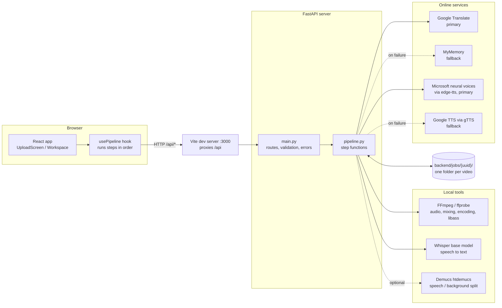
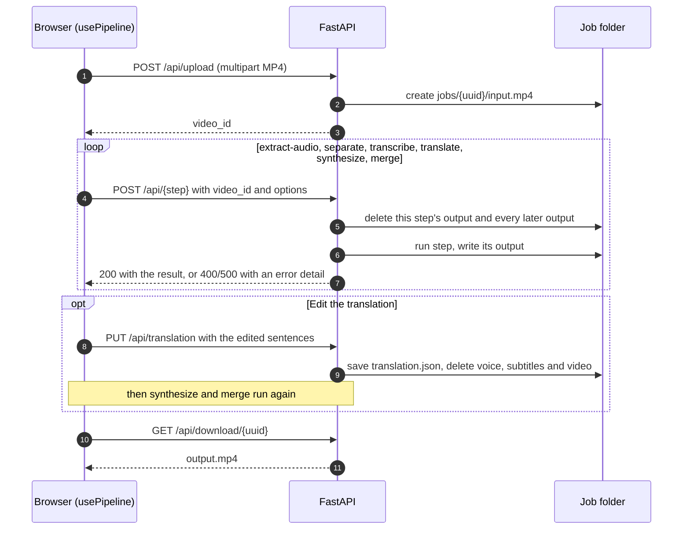

# Vaani

Vaani dubs a video into another language. Upload an MP4 and it transcribes the speech, translates
it, records a new voice track timed sentence by sentence to the original, adds subtitles, and returns
a finished MP4 together with an `.srt` subtitle file.

Speech recognition and background separation run locally with OpenAI Whisper and Demucs.
Translation and speech synthesis use free online services that need no API keys.

---

## Contents

- [Features](#features)
- [Architecture](#architecture)
- [Processing pipeline](#processing-pipeline)
- [Timing and subtitles](#timing-and-subtitles)
- [Job storage](#job-storage)
- [API reference](#api-reference)
- [Frontend](#frontend)
- [Project structure](#project-structure)
- [Requirements](#requirements)
- [Getting started](#getting-started)
- [Development](#development)
- [Configuration](#configuration)
- [Supported languages](#supported-languages)
- [Privacy](#privacy)
- [Limitations](#limitations)
- [Troubleshooting](#troubleshooting)
- [Tech stack](#tech-stack)

---

## Features

- **End-to-end dubbing.** Upload, audio extraction, transcription, translation, voice synthesis and
  merging in one guided flow.
- **Background sound kept (optional).** Demucs separates the speaker from music and ambience, the
  new voice is mixed over the original background, and Whisper transcribes the isolated speech.
- **Natural neural voices.** Microsoft neural voices, female or male, for every language in the
  interface. Falls back to Google TTS automatically if the voice service is unavailable.
- **Sentence-level timing.** Each translated sentence is spoken at the moment it was said in the
  original, so pauses are kept and the voice stays in step with the speaker.
- **Subtitles.** Burned into the picture (always visible, plays anywhere) or added as a separate
  track that viewers can switch on and off. Also downloadable as `.srt`.
- **Correct rendering for complex scripts.** Burned-in subtitles use complex text shaping, so
  Devanagari, Tamil, Bengali, Malayalam, Arabic, Japanese and Korean render correctly.
- **Translation fallback.** Google Translate first; MyMemory takes over automatically if Google
  rate-limits or fails.
- **Recoverable failures.** A failed step shows the reason and can be retried on its own, without
  repeating the steps before it.
- **Editable script.** Review the translation sentence by sentence next to the original, fix any
  line, and re-voice. Only the edited sentences are synthesised again.
- **Re-dub.** Dub the same video into another language reusing the existing transcript.
- **Workspace view.** Original and dubbed video, a clickable timestamped script that follows
  playback, live progress with per-step timings, and light and dark themes.
- **Safe by construction.** Job folders are addressed only by validated UUIDs, uploads are size
  and type checked, and every job is deleted after 24 hours.

---

## Architecture

Vaani has two parts: a React single-page app and a FastAPI server. The browser drives the pipeline
by calling one endpoint per step. The server does the work for that step inside the job's own
folder and returns when it is done. The server keeps no job state in memory, and the job folder
holds all intermediate results.



### Request flow



### Design decisions

| Decision | Reason |
|---|---|
| The client orchestrates the steps | Each step is a plain, idempotent HTTP call. Retrying a failed step or re-dubbing into a new language is just calling the same endpoints again from a different starting point. |
| Synchronous `def` routes | FastAPI runs them in a thread pool, so a long step such as transcription never blocks other requests. |
| The file system is the only state | A job survives a server restart, and each step's inputs and outputs can be inspected on disk. |
| Outputs are cleared before each step runs | A failed or repeated step can never leave a stale file for a later step to pick up. |
| Models are loaded once, each behind a lock | Whisper and Demucs are slow to load. The locks keep memory bounded by letting one job use each model at a time. |
| Background separation is optional and chunked | It roughly doubles processing time, so it is off by default. Audio is processed in 30-second chunks so memory stays flat however long the video is. |

---

## Processing pipeline

| # | Step | Endpoint | Reads | Writes | How |
|---|---|---|---|---|---|
| 1 | Upload | `POST /api/upload` | request body | `input.mp4` | Streams the upload into a new job folder. |
| 2 | Extract audio | `POST /api/extract-audio` | `input.mp4` | `audio.wav` | `ffprobe` confirms an audio stream exists, then `ffmpeg` writes 16 kHz mono WAV. |
| 3 | Separate voice | `POST /api/separate` | `input.mp4` | `vocals.wav`, `background.wav` | Only when the background is kept: Demucs splits speech from music and ambience. Otherwise skipped. |
| 4 | Transcribe | `POST /api/transcribe` | `vocals.wav` if present, else `audio.wav` | `transcript.json` | Whisper `base` on CPU. Segments are joined into timed sentences. |
| 5 | Translate | `POST /api/translate` | `transcript.json` | `translation.json` | Sentences are sent in newline-separated batches and split back, keeping each sentence's timing. |
| 6 | Voice and subtitles | `POST /api/synthesize` | `translation.json`, `audio.wav`, `background.wav` if present | `speech.wav`, `subtitles.srt`, `subtitles.vtt`, `subtitles.ass` | One speech clip per sentence (4 in parallel, cached), placed on a timeline the length of the original audio, then mixed over the background if it was kept. |
| 7 | Merge | `POST /api/merge` | `input.mp4`, `speech.wav`, subtitles | `output.mp4` | Replaces the audio track, then burns in or attaches the subtitles. |

### Background separation

When "Background sound: Keep" is chosen, the separate step runs the Demucs `htdemucs` model on
the video's audio at 44.1 kHz stereo:

- **Outputs:** the vocals become `vocals.wav`, and everything else (original minus vocals) becomes
  `background.wav`.
- **Chunking:** the audio is processed in 30-second chunks that overlap by 1 second and are
  crossfaded, so the joins are inaudible and memory stays at about 1.5 GB for any length.
- **Mixing:** the voice step mixes the new voice over `background.wav` at its original level, so
  music and ambience play exactly as before, without the original speaker.
- **Transcription:** Whisper transcribes `vocals.wav` instead of the full mix, which helps when
  there is music.
- **Cost:** on a 6-core laptop CPU it takes about 0.75 s per second of audio, plus about 13 s to
  load the model the first time. The model (about 80 MB) is downloaded on first use.

Re-dubbing and re-voicing reuse the separated tracks.

### Translation

- **Primary:** Google Translate through the public `translate.googleapis.com` endpoint. Requests
  are batched up to 4,500 UTF-8 bytes.
- **Fallback:** if Google returns an error or an unreadable response, the whole translation is
  retried with [MyMemory](https://mymemory.translated.net/) in batches of up to 450 bytes.
  MyMemory's anonymous quota is about 5,000 characters per day.
- **Batching:** both services preserve line breaks, so many sentences go in one request. If a
  service merges or splits lines, that batch is retried one sentence at a time.

### Voices

- **Primary:** Microsoft neural voices through [edge-tts](https://github.com/rany2/edge-tts),
  which needs no API key. Each interface language has a female and a male voice, for example
  Swara and Madhur for Hindi, or Pallavi and Valluvar for Tamil. The mapping is `VOICES` in
  `backend/pipeline.py`.
- **Fallback:** if the Microsoft service fails, every sentence is regenerated with gTTS, so one
  video never mixes two voices. Languages with no entry in `VOICES` use gTTS directly.
- **Reporting:** the step returns the voice it used, and the interface shows it, for example
  "Swara, Microsoft neural voice".

### Editing and the clip cache

The translation can be edited after the translate step, at any point when nothing is running.
`PUT /api/translation` replaces the text of each sentence (timing is kept), then deletes the
voice, subtitles and video made from the old text.

Each spoken sentence is cached in `clips/` under a hash of the voice and the text. When the voice
step runs again, sentences whose text and voice are unchanged reuse their clip, so editing one
line re-synthesises one sentence. Clips that no sentence uses any more are deleted at the end of
each run. Changing the voice or the language changes every key, so everything is regenerated.

### Merge modes

| Mode | Video | Audio | Subtitles | Speed |
|---|---|---|---|---|
| Burned in (default) | Re-encoded with libx264, `veryfast`, CRF 20 | AAC | Drawn into the picture with the `ass` filter and complex shaping | About 10 s for a 30 s 1080p clip on a laptop CPU |
| Separate track | Stream copied, untouched | AAC | `mov_text` subtitle track | Under a second |

---

## Timing and subtitles

Whisper returns short segments that often end mid-sentence. Vaani regroups them before translation
so that each sentence translates with full context and is spoken as one unit:

1. **Grouping.** A new sentence starts after sentence-ending punctuation, after a pause longer than
   1.5 s, or once a sentence reaches 15 s.
2. **Placement.** Each translated sentence is synthesised separately and placed at its original
   start time. Silence at the ends of each clip is trimmed first.
3. **Fitting.** If a clip is longer than the gap before the next sentence, it is sped up just
   enough to fit, up to 2x. If it still runs over, the next sentence starts right after it.
4. **Exact length.** The dubbed track is assembled as raw PCM on a timeline exactly as long as the
   original audio, then written to `speech.wav`.
5. **Subtitles.** Cues use the actual spoken times from step 3, not the original ones, so the text
   matches what is heard. Long sentences are split into subtitles of at most two 42-column lines,
   breaking after whole sentences where possible. Width is measured with CJK characters counting
   as two columns, so Japanese is wrapped correctly even though it has no spaces.

The subtitle cues are written in three formats:

| File | Used for |
|---|---|
| `subtitles.srt` | Download and the separate subtitle track in the MP4 |
| `subtitles.vtt` | The subtitle track in the in-browser preview |
| `subtitles.ass` | Burning in. Styled with an outline, and rendered with complex shaping so scripts such as Tamil and Bengali display correctly |

---

## Job storage

Each upload gets a folder at `backend/jobs/<uuid>/`:

```
input.mp4          original upload
audio.wav          16 kHz mono speech audio
vocals.wav         isolated speech (only when the background is kept)
background.wav     music and ambience without speech (only when the background is kept)
transcript.json    [{ start, end, text }] in the original language
translation.json   the same sentences, translated
speech.wav         dubbed voice track, 24 kHz mono
subtitles.srt      subtitles (download and MP4 track)
subtitles.vtt      subtitles (browser preview)
subtitles.ass      subtitles (burn-in)
output.mp4         final video
clips/             cached speech clip per sentence, named by a hash of voice and text
```

- **Isolation:** the server only accepts canonical UUIDs as `video_id`. A request can never
  address a path outside its own job folder.
- **Consistency:** before a step runs, and again if it fails, the step's outputs and the outputs of
  every later step are deleted.
- **Retention:** job folders older than 24 hours are removed when the next upload arrives.

---

## API reference

All routes are under `/api`. Request bodies are JSON unless noted. Errors return
`{ "detail": "<message>" }`.

| Method | Route | Body / query | Success response |
|---|---|---|---|
| `POST` | `/api/upload` | multipart field `file` (MP4, up to 500 MB) | `{ "video_id": "<uuid>" }` |
| `POST` | `/api/extract-audio` | `{ "video_id" }` | `{ "status": "done" }` |
| `POST` | `/api/separate` | `{ "video_id", "keep_background": false }` | `{ "kept": true \| false }` |
| `POST` | `/api/transcribe` | `{ "video_id" }` | `{ "sentences": [{ "start", "end", "text" }] }` |
| `POST` | `/api/translate` | `{ "video_id", "target_lang" }` | `{ "sentences": [...] }`, one per transcript sentence |
| `PUT` | `/api/translation` | `{ "video_id", "texts": ["..."] }`, one text per sentence | `{ "sentences": [...] }` |
| `POST` | `/api/synthesize` | `{ "video_id", "target_lang", "voice": "female" \| "male" }` | `{ "voice": "<voice used>" }` |
| `POST` | `/api/merge` | `{ "video_id", "burn_subtitles": true }` | `{ "status": "done" }` |
| `GET` | `/api/download/{video_id}` | `?filename=name.mp4` (optional) | the dubbed MP4 |
| `GET` | `/api/subtitles/{video_id}` | `?format=srt\|vtt&filename=name` (optional) | the subtitle file |

`target_lang` is a language code such as `hi` or `ta`; see [Supported languages](#supported-languages).
`filename` sets the download name and is sanitised before it is used in the response header.

| Status | Meaning |
|---|---|
| `400` | Invalid input or a step that cannot continue, with a readable reason (for example "This video has no audio track." or "No speech was detected in this video.") |
| `404` | Unknown `video_id`, or the requested output does not exist yet |
| `413` | Upload larger than 500 MB |
| `422` | Request body or query failed validation |
| `500` | Unexpected failure. The message names the step, and the full traceback is logged on the server |

Interactive documentation is served at `/docs` while the backend is running.

---

## Frontend

The interface is a two-screen app. The upload screen collects the video, the target language and
the subtitle mode. The workspace then shows the run as it happens.

| Area | Contents |
|---|---|
| Preview | Original and dubbed video, with playback position kept when switching. Shows file size, length and resolution. |
| Script | One row per sentence: timestamp, original text, and the translation in an editable box. Clicking a timestamp plays the preview from there, and the sentence being played is highlighted. Edited lines are marked, and "Re-voice" saves them and regenerates only the voice, subtitles and video. |
| Pipeline | Seven steps with live elapsed time, per-step durations, upload progress and an overall progress bar. On failure: the error message and a "Retry this step" button. |
| Export | Download the MP4, download the `.srt`, or re-dub into another language. |

How it is built:

- **`usePipeline`** (`src/lib/usePipeline.js`) owns all state: the selected file, language, voice
  and subtitle mode, each step's status and timing, the timed sentences, and errors. It exposes `start`, `retry`,
  `redub`, `revoice` and `reset`. A run counter ensures that a run abandoned by "New video" can
  never update the screen.
- **`api.js`** wraps axios and turns any server or network error into one readable message.
- **Styling:** Tailwind CSS with design tokens defined as CSS variables, which gives a light and a
  dark theme that follow the system setting and can be toggled. Text is set in IBM Plex Sans and
  IBM Plex Mono.
- **Safety:** the browser warns before the tab is closed while a step is running, and asks for
  confirmation before discarding a run in progress.
- **Accessibility:** the layout works from 360 px phone width upward, focus states are visible for
  keyboard users, and controls have accessible names.

---

## Project structure

```
.
├── .github/workflows/ci.yml  lint, tests, build and Docker images on every push
├── backend/
│   ├── main.py              FastAPI app: routes, request models, validation, error mapping
│   ├── pipeline.py          pipeline steps, translation, speech timing, subtitle generation
│   ├── tests/               pytest: text logic, API, FFmpeg integration (offline)
│   ├── requirements.txt     pinned runtime dependencies
│   ├── requirements-dev.txt adds pytest, ruff and httpx
│   ├── pyproject.toml       ruff and pytest settings
│   ├── Dockerfile
│   └── jobs/                created at runtime, one folder per upload (git-ignored)
├── frontend/
│   ├── index.html
│   ├── public/favicon.svg
│   ├── src/
│   │   ├── main.jsx
│   │   ├── App.jsx           switches between the upload screen and the workspace
│   │   ├── index.css         theme tokens (light and dark)
│   │   ├── lib/
│   │   │   ├── api.js        HTTP client, download URLs, error messages
│   │   │   ├── usePipeline.js  step runner and application state
│   │   │   ├── languages.js  supported target languages
│   │   │   ├── format.js     size, duration and clock formatting
│   │   │   ├── media.js      stops removed videos from loading
│   │   │   └── lib.test.js   Vitest unit tests
│   │   └── components/
│   │       ├── TopBar.jsx        logo, current file, new video, theme toggle
│   │       ├── UploadScreen.jsx  file picker, language, voice, background, subtitles
│   │       ├── Workspace.jsx     layout of the processing view
│   │       ├── VideoPanel.jsx    original and dubbed preview
│   │       ├── ScriptPanel.jsx   timed script with editable translation
│   │       ├── StepList.jsx      progress, timings, errors, retry
│   │       ├── ExportPanel.jsx   downloads and re-dub
│   │       └── ui.jsx            Button, ChoiceGroup, CopyButton, LanguageSelect, Panel
│   ├── vite.config.js       dev server on :3000, /api proxy
│   ├── eslint.config.js
│   ├── tailwind.config.js
│   ├── postcss.config.js
│   ├── nginx.conf           serves the build and proxies /api in Docker
│   ├── Dockerfile
│   └── package.json
├── docker-compose.yml
├── .gitignore
└── README.md
```

---

## Requirements

| Requirement | Version | Notes |
|---|---|---|
| Python | 3.10 or newer | Developed on 3.12 |
| Node.js | 18 or newer | Developed on 24 |
| FFmpeg and ffprobe | recent build on `PATH` | Must include libass and libx264 for burned-in subtitles. The "full" Windows builds from [gyan.dev](https://www.gyan.dev/ffmpeg/builds/) include both. |
| Internet connection | | For translation and speech synthesis, and for the one-time Whisper model download |
| Memory | about 2 GB free, 3 GB with background separation | Whisper `base` uses around 1 GB while transcribing; Demucs peaks at about 1.5 GB |

Check FFmpeg's subtitle support with:

```bash
ffmpeg -hide_banner -filters | grep -w ass
```

---

## Getting started

### With Docker

The quickest way to run everything. It needs only Docker:

```bash
docker compose up --build
```

Open <http://localhost:8080>. The first build takes several minutes. Models are downloaded on
first use and kept in a named volume, as are uploaded jobs. Give Docker at least 4 GB of memory
if you plan to keep background sound.

### Without Docker

#### 1. Backend

```bash
cd backend
python -m venv .venv
# Windows:      .venv\Scripts\activate
# macOS/Linux:  source .venv/bin/activate
pip install -r requirements.txt
uvicorn main:app --host 127.0.0.1 --port 8000
```

On Linux, add `--extra-index-url https://download.pytorch.org/whl/cpu` to the `pip install` to
get the CPU-only PyTorch build, which is about 2 GB smaller. The first transcription downloads the
Whisper `base` model (about 140 MB) and caches it.

#### 2. Frontend

In a second terminal:

```bash
cd frontend
npm install
npm run dev
```

Open <http://localhost:3000>.

#### 3. Production build (optional)

```bash
cd frontend
npm run build      # outputs frontend/dist
npm run preview    # serves the build on :3000 with the same /api proxy
```

### Deploying to Hugging Face Spaces

The `Dockerfile` at the repository root builds a single image for a
[Docker Space](https://huggingface.co/docs/hub/spaces-sdks-docker). FastAPI serves both the API and
the built frontend on port 7860, and the Whisper and Demucs models are baked into the image. The
Space settings are in the block at the top of this README. The free CPU tier (2 vCPU, 16 GB) is
enough.

1. Create a Space at <https://huggingface.co/new-space> and choose **Docker** with the
   **Blank** template.
2. Log in with a token that has write access: `hf auth login`.
3. Push this repository to the Space:

   ```bash
   git remote add space https://huggingface.co/spaces/<user>/<space>
   git push space main
   ```

The Space builds itself, which takes about 10 minutes. Its disk is wiped whenever it restarts or
goes to sleep, so jobs in progress are lost then.

---

## Development

```bash
# backend
cd backend
pip install -r requirements-dev.txt
ruff check .                 # lint
pytest                       # all tests, about 10 s
pytest -m "not integration"  # skip the FFmpeg tests, under 1 s

# frontend
cd frontend
npm run lint
npm test
```

| Suite | What it covers |
|---|---|
| `backend/tests/test_text.py` | Sentence grouping, translation chunking and batching, subtitle line breaking (including CJK width), SRT, VTT and ASS output |
| `backend/tests/test_api.py` | Upload limits, UUID validation, error mapping and output clean-up, request validation, translation edits, download filename sanitising, job expiry |
| `backend/tests/test_media.py` | Runs FFmpeg on generated video: audio extraction, sentence placement and speed-up, the clip cache, both merge modes, chunked separation and background mixing |
| `frontend/src/lib/lib.test.js` | Formatting, download URLs, error messages, step request bodies |

The tests need no network and no model downloads: a fake voice and a fake separator stand in for
the online voice service and Demucs. The GitHub Actions workflow runs the linters and both test
suites, builds the frontend, and builds the Docker images on every push.

---

## Configuration

| Setting | Where | Default | Purpose |
|---|---|---|---|
| `BACKEND_URL` | environment variable for the frontend | `http://127.0.0.1:8000` | Where Vite forwards `/api` requests |
| `MAX_UPLOAD_BYTES` | `backend/main.py` | 500 MB | Upload size limit |
| `JOB_TTL_SECONDS` | `backend/main.py` | 24 hours | How long job folders are kept |
| `MAX_SENTENCE_SECONDS`, `SENTENCE_GAP_SECONDS` | `backend/pipeline.py` | 15 s, 1.5 s | Sentence grouping |
| `SEPARATION_MODEL` | `backend/pipeline.py` | `htdemucs` | Demucs model for background separation |
| `SEPARATION_CHUNK_SECONDS`, `SEPARATION_FADE_SECONDS` | `backend/pipeline.py` | 30 s, 1 s | Separation chunk length and crossfade |
| `MAX_TEMPO` | `backend/pipeline.py` | 2.0 | Maximum speed-up of a sentence |
| `VOICES` | `backend/pipeline.py` | 18 languages | Microsoft neural voice for each language, as (female, male) |
| `TTS_WORKERS` | `backend/pipeline.py` | 4 | Parallel speech requests |
| `CAPTION_LINE` | `backend/pipeline.py` | 42 | Subtitle line width in columns |

If port 8000 is already in use, run the backend on another port and point the frontend at it:

```bash
uvicorn main:app --host 127.0.0.1 --port 8001
```

```bash
# macOS/Linux
BACKEND_URL=http://127.0.0.1:8001 npm run dev
```

```powershell
# Windows PowerShell
$env:BACKEND_URL="http://127.0.0.1:8001"; npm run dev
```

---

## Supported languages

Source language: any language Whisper recognises, detected automatically.

Target languages offered in the interface:

| Code | Language | Code | Language | Code | Language |
|---|---|---|---|---|---|
| `hi` | Hindi | `kn` | Kannada | `it` | Italian |
| `bn` | Bengali | `ml` | Malayalam | `pt` | Portuguese |
| `ta` | Tamil | `ur` | Urdu | `ru` | Russian |
| `te` | Telugu | `es` | Spanish | `ar` | Arabic |
| `mr` | Marathi | `fr` | French | `ja` | Japanese |
| `gu` | Gujarati | `de` | German | `ko` | Korean |

The backend accepts any language gTTS supports. To offer another one, add it to
`frontend/src/lib/languages.js`, and optionally add its neural voices to `VOICES` in
`backend/pipeline.py`. Without an entry there, it uses the gTTS voice.

---

## Privacy

| Data | Where it goes |
|---|---|
| Video and audio | Stay on the machine running the backend. Transcription and background separation are local. |
| Transcript text | Sent to Google Translate, or to MyMemory if the fallback is used |
| Translated text | Sent to Microsoft's speech service through edge-tts, or to Google's through gTTS if the fallback is used |
| Stored files | Kept in `backend/jobs/` and deleted 24 hours after upload |

---

## Limitations

- **Voice.** The dubbed voice is a stock neural voice. It does not copy the original speaker's
  voice or emotion, and every speaker in a video gets the same voice.
- **Third-party services.** Google Translate, Microsoft's voice service and gTTS are used through
  public endpoints without API keys. They are rate-limited and not guaranteed. MyMemory's free
  quota is small.
- **Timing.** A translation much longer than the original can still overrun its slot after the 2x
  speed-up, which pushes later sentences slightly back.
- **Background separation.** Demucs can leave faint traces of the original voice in the
  background, especially with loud or reverberant speech, and it is slow on CPU.
- **Transcription.** Whisper `base` favours speed over accuracy. Noisy audio or several speakers
  reduce quality.
- **Long requests.** Each step is a single HTTP request, so a very long video means long-running
  requests. There is no background job queue.
- **No user accounts.** Anyone who can reach the server can use it. Run it locally or behind your
  own authentication; it is not intended for public deployment as is.
- **Input format.** Only MP4 uploads are accepted.

---

## Troubleshooting

| Symptom | Cause and fix |
|---|---|
| "Could not reach the server. Make sure the backend is running." | The backend is not running, or Vite is proxying to the wrong port. Start uvicorn and check `BACKEND_URL`. |
| Requests return 404 or 405 for every route | Another application is listening on port 8000. Run the backend on a different port as shown in [Configuration](#configuration). |
| "Translation services are unavailable right now" | Google rate-limited this IP and MyMemory's daily quota is used up. Wait a few minutes and use "Retry this step". |
| The step list shows "Google TTS voice" instead of a neural voice | Microsoft's voice service could not be reached, so the gTTS fallback was used. Retry later, or update edge-tts with `pip install -U edge-tts` if Microsoft changed its service. |
| "Text-to-speech failed: 429 ..." | Both voice services failed and Google TTS rate-limited this IP. Wait, then retry the step. |
| "ffmpeg failed: ..." or `FileNotFoundError: ffmpeg` | FFmpeg is missing from `PATH`. Install it and open a new terminal. |
| Burned-in subtitles show boxes or broken vowel signs | The FFmpeg build lacks libass or HarfBuzz. Install a full build. |
| "No speech was detected in this video." | The audio is silent or contains only music. |
| "Video not found. Please upload it again." | The job is older than 24 hours, or was created by an older version with a different file format. |
| The backend process stops during transcription or separation | The machine ran out of memory. Close other heavy applications and retry, or choose "Background sound: Remove". |
| "Separate voice" takes a long time | Expected: about 0.75 s per second of audio on CPU, plus a one-time model download. Choose "Remove" when the video has no music. |

---

## Tech stack

| Layer | Technology |
|---|---|
| Frontend | React 18, Vite 5, Tailwind CSS 3, axios, lucide-react |
| Backend | Python, FastAPI, Uvicorn, Pydantic |
| Speech to text | OpenAI Whisper (`base`) |
| Source separation | Demucs (`htdemucs`), PyTorch |
| Translation | Google Translate, MyMemory (fallback) |
| Text to speech | edge-tts (Microsoft neural voices), gTTS (fallback) |
| Media | FFmpeg, ffprobe, libass, libx264 |
